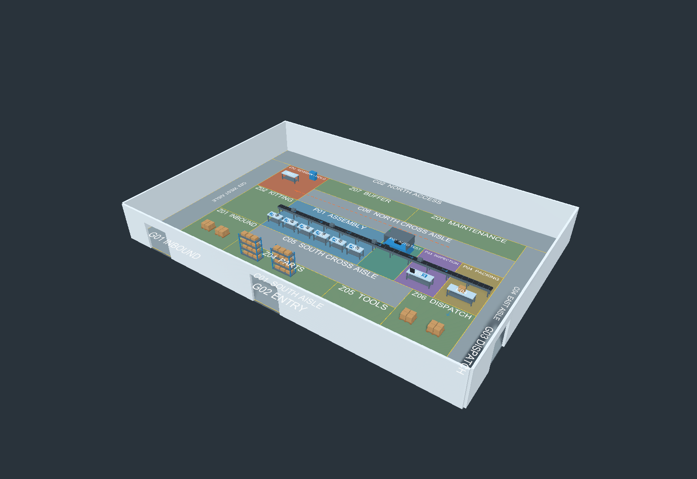

# KKU XR / Industrial Props

산업용 소품을 제작하는 Three.js 프로젝트와, ProBuilder로 구성한 Unity 공장 맵을 함께 관리합니다.

## 프로젝트 구조

```text
kku/
├── src/                   # Three.js 소품 생성기 및 미리보기
├── public/models/         # GLB 모델
├── KKU_XR/                # Unity 프로젝트
│   ├── Assets/FactoryMap/  # 공장 씬, 프리팹, 메시, 재질, 1인칭 플레이어
│   ├── Packages/          # 패키지 목록 및 잠금 파일
│   └── ProjectSettings/   # 입력, 렌더링, 빌드 씬 설정
└── docs/                  # 참고 도면 및 검증 로그
```

## Unity 공장 실행

1. Unity Hub에서 **Add project from disk**로 `KKU_XR` 폴더를 추가합니다. 저장소 루트가 아닌 `KKU_XR` 폴더를 선택합니다.
2. **Unity 6000.6.4f1**로 엽니다. 첫 실행 시 패키지 복원과 에셋 임포트가 진행되므로 인터넷 연결이 필요합니다.
3. `Assets/FactoryMap/FactoryMap_36x24.unity`를 엽니다. 메뉴 **Tools > Factory Map > Open Factory Scene**으로도 열 수 있습니다.
4. **Play**를 누른 뒤 **Game 화면을 클릭**합니다.

| 입력 | 동작 |
|---|---|
| W / A / S / D | 전진 / 왼쪽 / 후진 / 오른쪽 |
| 마우스 이동 | 시야 회전 |
| Esc | 마우스 잠금 해제 |
| Game 화면 왼쪽 클릭 | 마우스 잠금 및 조작 재개 |

플레이어는 `(18, 0, 2)`에서 북쪽을 바라보고 시작합니다. 이동 속도는 4 m/s, 눈높이는 1.65 m입니다. 대각선 이동 속도는 동일하며 위아래 시야는 ±85도로 제한됩니다. 벽과 컨베이어 등의 설비에는 충돌이 적용되어 있습니다.

### 공장 구성과 편집

[참고 도면](docs/factory-layout-36x24.pdf)의 좌표에 맞춘 36 × 24 m 공장입니다. 24 m 컨베이어, 조립 작업대 6개, 자동 시험·외관 검사·포장·재작업 구역, 랙과 팔레트를 포함합니다. 기본 시작 씬도 공장 씬으로 설정되어 있습니다.

- `FactoryMap.prefab`: 공장 구조. ProBuilder 메시 373개를 편집할 수 있습니다.
- `FactoryMeshes.asset`, `Materials/`: 프리팹이 참조하는 메시와 재질. 함께 관리해야 합니다.
- `FactoryFirstPersonPlayer.prefab`: 1인칭 플레이어.
- `Scripts/FactoryFirstPersonController.cs`: WASD, 마우스 시야, 커서 잠금 및 중력 처리.
- `Editor/FactoryMapBuilder.cs`: 최초 공장 생성 코드. 기존 프리팹이 있으면 덮어쓰기를 중단합니다.

ProBuilder로 개별 면·에지·버텍스를 수정하려면 프리팹 모드에서 편집하거나, 씬의 공장 루트를 **Unpack Prefab**한 뒤 편집합니다. 천장은 평면 확인과 편집을 위해 생략했습니다. 현재 컨베이어와 생산 설비는 정적 모델이며, 제품 이송·검사 판정·XR 헤드셋 조작은 구현하지 않았습니다.



[평면 렌더 보기](KKU_XR/Assets/FactoryMap/FactoryTopDown.png)

## Unity 로그로 유효성 검사

일반 로그는 Unity의 **Window > General > Console**에서 확인합니다. Console 메뉴의 **Open Editor Log**로 원본 Editor 로그 위치를 확인할 수 있습니다. 이 환경에서는 프로젝트의 `Logs/Editor.log`를 사용하며, 플랫폼과 에디터 설정에 따라 위치가 다를 수 있습니다.

검증은 메모리에 임시 플레이어를 생성해 이동·시야·충돌을 확인하고, 임시 오브젝트를 삭제합니다. 저장된 씬을 덮어쓰지 않습니다. 실제 키보드·마우스 조작감과 커서 잠금은 위 실행 방법에 따라 Game 화면에서 확인합니다.

### 에디터에서 검사

Play 모드를 종료하고 **Tools > Factory Map > Validate Saved Factory**를 실행합니다. Console에 `FACTORY_VALIDATION_PASS`가 나오면 검사에 통과한 것입니다.

### 명령줄에서 검사

같은 `KKU_XR` 프로젝트를 연 Unity 에디터를 닫고, 저장소 루트에서 다음을 실행합니다. `UNITY_EDITOR`는 설치된 Unity 실행 파일 경로로 바꾸세요. 아래는 macOS 예시입니다.

```bash
UNITY_EDITOR="/Applications/Unity/Hub/Editor/6000.6.4f1/Unity.app/Contents/MacOS/Unity"
mkdir -p KKU_XR/Logs
"$UNITY_EDITOR" -batchmode -quit --burst-disable-compilation \
  -projectPath "$PWD/KKU_XR" \
  -executeMethod FactoryMapValidation.ValidateBatch \
  -logFile "$PWD/KKU_XR/Logs/factory-validation.log"
```

`--burst-disable-compilation`은 검증 실행에만 적용되며 프로젝트 설정을 변경하지 않습니다. 이번 검사 환경의 Burst 네이티브 링커 실행 권한 문제를 피하기 위해 사용했습니다. Windows에서는 Unity 설치 경로의 `Unity.exe`로 같은 인자를 전달할 수 있습니다.

**성공 기준:** 프로세스 종료 코드 `0`과 `FACTORY_VALIDATION_PASS` 로그입니다. 실패하면 종료 코드 `1` 및 `FACTORY_VALIDATION_FAILED` 메시지를 확인합니다. `error CS...`는 스크립트 컴파일 실패이므로 먼저 해결해야 합니다. 성공한 검사는 저장소의 [검증 요약 로그](docs/validation/factory-unity-validation.log)를 갱신합니다.

검사 항목은 다음과 같습니다.

- ProBuilder 메시 373개와 메시·재질·스크립트 참조의 유효성.
- 36 × 24 m 바닥, 24 m 컨베이어, 조립 작업대 6개 및 시작 씬 설정.
- 플레이어 시작 위치, 카메라 높이, 활성 카메라·AudioListener 각 1개, Input System 설정.
- 전진·대각선 이동 속도, 마우스 좌우 회전 및 위아래 시야 제한.
- 바닥·서쪽 벽·컨베이어 충돌.

검증 결과와 실제 로그 발췌는 아래 요약 로그에 보관합니다. 원본 Editor 로그 전체는 인증·실행 환경 정보가 섞일 수 있으므로 커밋하지 않습니다.

### 확인한 결과 (2026-10-13)

기존 캐시를 복사하지 않은 `KKU_XR` 프로젝트에서 Unity를 실행해 패키지 복원, 스크립트 컴파일 및 저장된 씬 로드를 거쳐 검사했습니다. 종료 코드 `0`을 확인했습니다. 요약 로그의 주요 출력은 다음과 같습니다.

```text
FACTORY_ASSETS_PASS | ProBuilderMeshes=373 | MissingMeshes=0 | MissingMaterials=0 | MissingScripts=0
FACTORY_LAYOUT_PASS | Floor=36x24m | Conveyor=24m | AssemblyStations=6
FIRST_PERSON_MOVEMENT_PASS | Forward=4m/s | Diagonal=4m/s | MouseYaw=12deg | PitchLimit=85deg
FIRST_PERSON_COLLISION_PASS | Floor=pass | WallStopX=0.33 | ConveyorStopZ=11.37
FACTORY_VALIDATION_PASS
```

기존 Three.js 프로젝트도 `npm test` **100개 통과**, `npm run build` **성공**을 확인했습니다. 빌드의 500 kB 초과 청크 경고는 남아 있습니다. 브라우저 및 실제 키보드·마우스 조작감은 자동 검증 범위에 포함되지 않습니다.

## Three.js 프로젝트 실행

저장소 루트에서 실행합니다. Unity 프로젝트와 별도로 동작합니다.

```bash
npm ci
npm run dev
```

검증 및 빌드:

```bash
npm test
npm run build
```

## Git에 포함하는 파일

Unity의 `Assets/`와 **모든 `.meta` 파일**, `Packages/manifest.json`, `Packages/packages-lock.json`, `ProjectSettings/`를 함께 커밋합니다. `.meta`는 에셋 GUID를 유지하는 데 필요하므로 제외하면 씬·프리팹 참조가 끊길 수 있습니다.

`.gitignore`는 Unity의 `Library/`, `Temp/`, `Logs/`, `UserSettings/`, 빌드 결과와 작업용 `tmp/`, `output/`을 제외합니다. 이 폴더들은 업로드하지 않아도 Unity가 필요한 캐시를 다시 생성합니다. 검증에 필요한 정리된 로그는 예외적으로 `docs/validation/`에 보관합니다.

추가한 Unity 소스는 약 7 MiB이며, 가장 큰 파일은 약 3.31 MiB의 공장 프리팹입니다. 현재 파일은 일반 Git으로 관리할 수 있는 크기입니다.
